# Voxel Lighting

Polygonal and Voxel lighting were the first models to ever show up in Computer Graphics. Back in the day, Voxel lighting was deemed too computer-heavy to be calculated and was quickly forgotten by the community. The fast and all-purpose Polygonal model of renderization and lighting was developed upon throughout the years, making huge advancements towards realism with all sorts of effects, shadow casting, Raytracing, etc..

A few decades later, Voxel Lighting made a new appearence on the realm of games. Since computers have evolved, so did the computing power necessary to run these light models.

It's no secret that Draconic Revolution is a Voxel-based game. Yet it was using the famous Polygonal model of lighting. Using Polygonal Lighting in a Voxel world generates all sorts of lighting and shading artifacts. Sometimes, places were simply too dark or too lit up. There was no middle ground and definitely the transitions were way too noticeable.

The whole idea of this document is to explain how Draconic Revolution not only had a brand-new implementation of Voxel Lighting, but also had it implemented on-top of the current Polygonal model with all of its perks and realism features.

### Topics

 - What is Voxel Lighting?
 - Step-by-Step implementation
 - Light Through Chunk Layers
 - Extra Lights
 - Custom Interpolation Shaders
 - New Vertex Shaders
 - Ground Emission Problem and Solution
 - Moving Light Problem and Solution
 - Brightness and Exposure
 - Realtime Light Budget (HDRP)

## What is Voxel Lighting?
In the real world, light floods into a room, and will bounce around and to other unlit rooms. This behaviour can be done in Unity HDRP, but not for non-static procedually generated objects. And well, if you don't know Draconic Revolution, then let me tell you a secret: we have the **worst** of all rendering worlds here. We have non-staticism (object properties can and will change), procedually generated (objects aren't created prior to runtime), can't be lightmapped by Polygonal Lighting (can't have lightmaps baked to them for quick and precise lighting) and can't have light bounces in real-time (light won't scatter off of hit surfaces).

I knew that to make the perfect lighting, I would need to fix most of the inherent problems that came with the nature of the game. So Voxel Lighting was my way out!

Voxel Lighting doesn't care (too much) about pixel light rays being shot, but it cares about shooting voxel-sized light rays. In simpler terms, Voxel Lighting implements a local light level for every Voxel in the world. 

**No, we are not creating real-time lights for every voxel in the world, keep reading!**

## Step-by-Step Implementation

### The Process
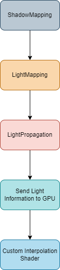

### ShadowMapping
Shadowmapping is the process where the shadows are calculated given the light information in the Scene. While it's pretty straightforward in Polygonal Lighting, Shadowmapping in Voxel Lighting is definitely different.
For every Voxel in a chunk, we need to find out the ShadowCode for them. The ShadowCode is defined as following:

 - Defined as 0 if current Voxel is a solid block
 - Defined as 1 if current Voxel is a transparent block
 - Defined as 2 if current Voxel has contact with direct sunlight or maximum luminosity Extra Light
 - Defined as 3 if current Voxel receives light from the sun but is not in contact with it (like light being shined into the underground)
 - Defined as 7, 8, 9, 10, 11, 12 if current Voxel receives light from a neighbor chunk, each code representing the direction the light received travels (7-10 are the horizontal neighbors, 11 is the chunk above and 12 the chunk below)

During the ShadowMapping process, only ShadowCode 0, 1 and 2 is set. The only exception are the directional ShadowCodes in the borders of the chunk, which are not tampered with if the current ShadowMap has them at some point for Natural Light. The horizontal borders keep every direction, while the top and bottom of the chunk only keep the light received from the chunk above (11) and below (12). Extra Lights handling delete all occurrences of 7-10 ShadowCodes. See more at the Extra Lights section!

## LightMapping

Now things get fun. Lightmapping is meant to assign the local light value of each Voxel in a chunk.
The algorithm is pretty simple:

 1. For every sunlight affected voxel, assign Light Level 15
 2. Add the unlit neighbors of these sunlight affected blocks to a Breadth-First-Search queue
 3. Iterate through the queue, lowering the light level by one each time and set these voxels to their respective light levels and ShadowCode 3.
 4. Find every directional light received from other chunk voxels (the ones that have untampered ShadowCode 7-10) and add them to another Breadth-First-Search queue.
 5. Iterate through the queue, checking if the received light should be further propagated

## LightPropagation

Imagine that we have the entrance to a cave perfectly fitting a chunk and this chunk's neighbor is directly into sunlight. Given the implementation of lighting so far, one chunk would be totally dark while the other would be totally lit. It makes sense that light should propagate between chunks so that this scenario won't happen.

We compare the ShadowCode of the bordering blocks of every two chunks to figure out what WorkCode should be assigned to the pair. A WorkCode simply represents a routine of handling the given pair of ShadowCodes. The following tables can explain it better:

| **Shadow Pair** | **Shadow Translation** | **WorkCode** | **What the WorkCode means** |
|--|--|--|--|
| 0 & 0  | Border blocks are both solid | None | Do nothing |
| 0 & 1 | Solid block and Empty/Transparent block | None | Do nothing |
| 0 & 2 or 3 | Solid block and Sunlight affected block | 1 | Set neighbor chunk to update without propagating their light |
| 1 & 1 | Both transparent and unlit blocks | None | Do Nothing |
| 1 & 2 or 3 | Transparent unlit and Sunlit block | 2 | Propagates light to neighbor chunk and set their ShadowCode as directional (7-10) |
| 2 & 2 | Both blocks in direct sunlight  | None | Do Nothing |
| 2 & 3 | In direct sunlight and indirectly lit by sun | 6 | If sunlight from one is stronger than the local propagated indirect light of other, then propagate |
| 3 & 3 | Two indirectly sunlit blocks | 3 | Propagate to the chunk that has the lowest light level |
| 0 & 7-10 | Solid block and directional shadows | 7 | Checks if the directionals chunk has voxels around it with greater light value and same shadow. If not, propagate-delete them  |
| 1 & 7-10 | Unlit block and directional shadows | 4 | Propagates to a third chunk or dies out because of lack of transmitter shadows (Shadows that have ShadowCode 2 or 3) |
| 2 or 3 & 7-10 | Direct sunlit block and directional shadows | 5 | Tries to propagate to the chunk with the lowest light level overwritting directional shadows |
| 7-10 & 7-10 | Directional shadows meet other directional shadows | 5 | Tries to propagate to the chunk with the lowest light level overwritting directional shadows |

Okay, that seems hard... and it was.
Also there are light bounces. Here, we are describing a simple two-chunk propagation, but there's also the complex two-chunk propagation and multi-chunk propagation.

A complex two-chunk propagation was nicknamed "Chunk Bounce". It happens when a block of Chunk 1 propagates to Chunk 2 and the same light comes back to Chunk 1. This can happen up to 4 times.

Multi-chunk propagation is when a single block in a chunk propagates directional light to multiple ones (like the corner border of 4 chunks).

## Light Through Chunk Layers

The world is a stack of chunk layers (Surface, Underground, Hells and Core), so a shaft dug from the Surface must bring sunlight down to every layer it crosses.

- **Direct sunlight**: a voxel is in direct sunlight (ShadowCode 2) if it's above the light-blocking blocks of its column and direct sunlight enters the top of its column. Sunlight enters the top of a chunk through the columns where it leaves the bottom of the chunk above: the columns whose bottom voxel is in direct sunlight. These columns are the chunk's **SunExitMask**. The top layer always receives the open sky, so a shaft lights every layer it goes through.
- **Unloaded layers**: the `LightingSystem` keeps the last SunExitMask of every chunk position it lit, even after the chunk is unloaded, since the layer above is usually not streamed. Positions that were never lit count as the open sky. Chunks always use the kept mask of the chunk above, and when a kept mask changes the chunk below is calculated again, so opening or closing a shaft anywhere in a column updates every layer under it. A chunk waits for the light of the chunk above before it's calculated, so it's rarely calculated twice.
- **Indirect light**: light that goes around corners into the next layer travels through the vertical borders with LightPropagation, like the horizontal ones. Vertical borders are always propagated from the upper chunk (border ym of the upper chunk), so the same rules apply no matter which chunk asked for it. If the top of the lower chunk is in direct sunlight while the bottom of the upper chunk isn't, the lower chunk was lit with an outdated sky and is calculated again.
- **Verification**: before a chunk is built, its borders are verified to find where light should be propagated. Light is pushed out of the chunk, since every horizontal neighbor is verified when it's drawn too. Vertical neighbors are not drawn together, so the vertical borders are verified both ways. Chunks that change after their neighbors were drawn (block changes, or a new sky from above) verify every border both ways. Chunks updated by the LightPropagation itself don't verify again, or neighbors could update each other forever. Since light received from the chunk above or below is kept through calculations, a vertical border is also verified when a voxel holds light received from a neighbor voxel that became solid, so light without a source is removed.

## Asynchronous Light Calculation

On the client, the ShadowMap and LightMap of every loaded chunk are calculated in worker threads by the `LightingSystem`:

- Calculations run nearest to the player first, and are started twice per frame. The amount running at the same time is the job workers of the process left after the build slots (see `ChunkLoader.CalculateJobSlots`), up to `CLIENT_LIGHT_SLOTS`.
- A chunk has at most one calculation queued or running. Calculations work on copies of the chunk data and write them back once done.
- A chunk waits for the light of the chunk above it. Once a chunk is calculated, the chunk below it is calculated again if the sunlight leaving this one changed (see Light Through Chunk Layers).

Everything else runs in the main thread, as before:

- A chunk is drawn once the light of its 8 neighbors and the chunks above and below it is calculated. Right before it's built, its borders are verified and LightPropagation runs with its neighbors.
- Chunk updates (block changes) calculate their light right away, verify their borders both ways and then propagate it, so changes show without delay, also in the neighbor chunks.
- Anything that needs the light of a chunk that is still queued or being calculated (like LightPropagation reaching it) finishes its calculation in the main thread first (`EnsureLit`), so light is always calculated before it's propagated.

## Sending data to the GPU

This part is the one that sends the Light Level calculated for the Voxels to their respective vertices. That part shouldn't be hard, right? WRONG!

In order to get a decent gradient out each vertice, a Voxel's vertex light shouldn't always be the same as its local light level. It must take into consideration the light of it's neighbors as well, especially bordering chunks. For that, every vertice is assigned the highest light value out of the 4-voxel-junction it generates. 

Explaining like that seems easy, but it took me over a month to get it right!

Also note that the order in which the vertices are written heavily affects the order at which light information should be gathered. If you are developing a game and are creating voxels out of plain code, remember to create a standard order for drawing vertices. Clockwise rendering is the one I'm using in most (if not all) cases.

## Extra Lights

Alright, now take everything that was just said in the entire past Section and LITERALLY double that. 

Extra Lights are lights that don't come from the sun (torches, magic, light switches, etc.). They are handled in a similar way, only changing its Shadow Code 2 to symbolize maximum luminosity blocks. Whenever a Voxel contains both Natural Light and Extra Light information, the highest valued one will be used by the Shader.

Note that Extra Lights are constantly calculated and directional Extra Lights are always deleted whenever the ShadowMapping stage kicks in.

## Custom Interpolation Shaders
In order to get the modern look (and to work towards realism in a Voxel Lighting engine), we need to get perfect gradients between light levels. So for every pixel, there must have a gradient happening... Just imagine how hard and CPU intensive it would be to Lerp every pixel on the screen...

Luckily, the Vertex->Fragment shader struct does that work for us. For those unaware, the Vertex Shader operates on Vertices, sends the data to Interpolators that create the perfect interpolation of values (like normals and colors), so that the Fragment Shader can work on every pixel independently.

Implementing these Gradients in Shader Graph requires tweaking the Vertex Shader (don't be afraid, really) by adding the Light Level information to a Custom Interpolator, and retrieving it later to use in the Fragment Shader.

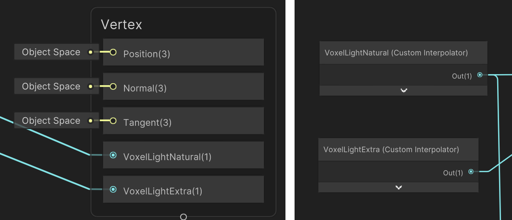

By the way, the Light Information is used as a Color multiplier. Light Level 0 means that whatever Color should have been drawn in a pixel becomes (almost) black, and so on. That's how we cast "Voxel Shadows". How the light level becomes brightness is explained in Brightness and Exposure.

## New Vertex Shaders

The Chunk Building pipeline was revamped, supporting unlimited Custom Shaders. That made me change the Water Shader and adding the new Leaves Shader. Now, both Leaves and Water move. How the Leaves wind stays stable far from the world origin is explained in [Chunk_Renderer.md](Chunk_Renderer.md) (Far from the World Origin).

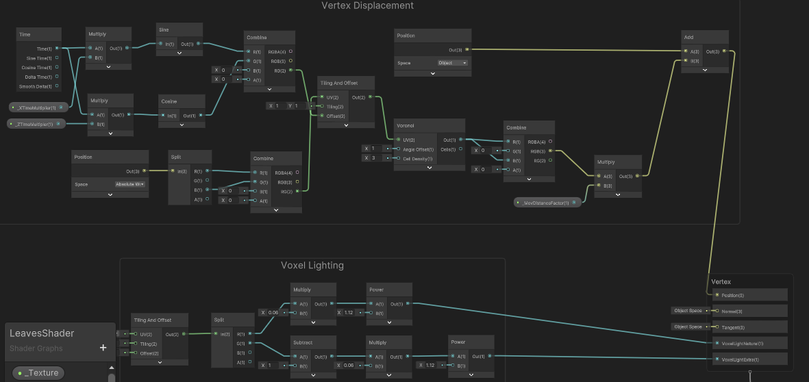

## Ground Emission Problem and Solution

After all of this, we still had a problem. Well, you see, what we are doing here is basically casting "Voxel Shadows". The real light still comes from the Polygonal model, so if the sun shines light into object A, and its shadows obscures object B, then Voxel Lighting won't help object B. That may make sense to most of you, but you should realize that the Underground would be dark even if we poke a hole in the ceiling to the surface.

The ground of the caves were 100% dark while the walls and ceilings were lit. Why is that? Simple, the materials weren't Double Sided. That means that the Shadows casted by the surface ground affected the only the places where the normals were similar, a.k.a the cave ground. Switching to Double Sided made everything darker.

To fix the extreme darkness now, the concept of Ground Emission was added. Emission is the amount of light coming from an object. Ground Emission makes all sky-facing normal voxels emit light given their light level. That not only makes the ground normally visible, but also shines light into the surrounding walls and ceiling, simulating real-time and real-life light bounces, something that is unique to Draconic Revolution in terms of Voxel Lighting implementation.

## Moving Light Problem and Solution

This is definitely the most confusing glitch I have found when dealing with Light. This effect that has absolutely no formal name (Shadow Sizzling, maybe?) was stumbled upon.

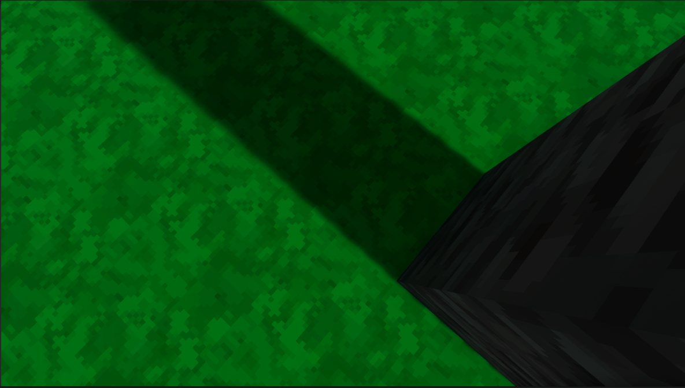

The cause was rather unexpected: the sun is moving too fast and too slow at the same time.
Let me explain. It seems like Polygonal Lighting has a very hard time dealing with moving directional lights. The real-time ShadowMapper seem to "switch frames" in a weird way whenever Shadows need to be recalculated too quickly. To make matters worse, the rotation of the directional light also can make the sizzling more evident.

To fix that, I had to drop the main Directional Light's update rate to a few times a second, instead of every 2 frames. Also, the trajectory of the main light was changed. It slightly curves away from the center at 12PM and goes back to center until sunset. Additionally, I also increased the Shadow Resolution and Distance.

## Brightness and Exposure

Nights and caves should be almost pitch black, and lights should be bright without turning white. Every part of the rendering pipeline is tuned towards that.

### Voxel Light in the Shaders

All voxel shaders (Ground, Objects, SolidObjects, Leaves, Ice, Water, the clothing shaders and DropItem) call the same function, `VoxelLightShade` in `Assets/Scripts/Rendering/ShaderFunctions/VoxelLightIntensity.hlsl`. Change the lighting there, not in the graphs. It receives the natural and extra light levels (normalized as level/15), the world position and the albedo, and returns:

 - **albedoMask**: multiplies the Base Color. Light levels go through a curve where every level below 15 multiplies the brightness by `_VoxelLightFalloff` (0.8). A linear curve looks flat near the light and then drops to black too quickly.
 - **extraEmission**: the brightness given by Extra Lights (light blocks and moving lights), added to the Emission. It only scales the surface's own color, so it never tints anything. Its intensity (`_ExtraLightIntensity`, in nits) does not depend on the sky, so lights look the same in every biome and time of day. The Shaft Light and Shaft Ambient of underground ambiences are added here too (see Caves).

Extra Lights have no color in the Voxel Lighting. The color of a light comes from the realtime Point Light of its source: the Light Profile of a block (see Realtime Light Budget) or the Light of an item or animation. So a light of a new color is a block with `luminosity` for its brightness plus a Light Profile with the color. A light source without a Point Light only makes things brighter.
 - **skyOcclusion**: goes into Occlusion. Natural light is how much of the sky a voxel sees, so sky ambient and sky reflections fade without it. Without this, smooth blocks reflected the sky in pitch-black caves.

An unlit voxel keeps `_VoxelLightFloor` of the sky ambient (split between albedoMask and skyOcclusion), so it is near-black instead of black. `ShaderLoader` sets the globals and `AmbientHandler` sets the floor of each biome. Moving lights use the brightest light reaching the pixel. Water reads the Light UV (TexCoord3) directly in the fragment stage, and its emission is masked too, since water is self-lit.

### Entities

Players and dropped items don't have voxel vertices. `EntityVoxelLight` (client only, added by `ChunkLoader` and `EntityHandler`) samples the light of the block an entity is in a few times per second, smooths it, and sends it to the `_EntityLightNatural` and `_EntityLightExtra` properties of its renderers through MaterialPropertyBlocks. It reads light through `ChunkLoader.GetLight`, which never forces a light calculation and returns -1 while a chunk's light isn't ready. Renderers without the component (like the character creation menu) use the property defaults, which are fully lit.

### Exposure

The camera uses HDRP's Automatic Histogram exposure, but `AmbientHandler` only lets it move in a small window around the biome's base exposure (`GetExposureBase`, in EV100): `EXPOSURE_ADAPT_BRIGHTEN` below and `EXPOSURE_ADAPT_DARKEN` above. Normal auto-exposure brings every scene back to mid-gray, which lit up caves and nights and made torches blow out to white. Now darkness comes from the light itself, and the camera only adds a small "eyes adjusting" effect.

### Caves

Caves can be in any layer and biome. A cave in the surface layer uses the preset of its surface biome, so `AmbientHandler` also measures how enclosed the camera is: the **Cave Factor**. A few times per second it reads the Natural Voxel Light at the camera and at the player's middle point (`ChunkLoader.GetLight`). Level `CAVE_LIGHT_DARK` (4) or lower is a full cave, level `CAVE_LIGHT_OPEN` (12) or higher is the open sky, and the factor fades slowly between them. Inside caves:

 - Fog is not lit by the sky (`globalLightProbeDimmer` keeps `CAVE_FOG_AMBIENT_KEPT`, 0%), so it stays dark instead of glowing. Light sources light it normally.
 - The sun and moon don't light the fog.
 - Auto-exposure can't brighten the image at all.
 - **Dark Adaptation**: unlit surfaces near the camera glow very faintly (`DARK_ADAPTATION_INTENSITY`, in nits), like eyes getting used to the dark. The glow fades to black at `DARK_ADAPTATION_RADIUS` blocks, and faces pointing at the camera get more of it than faces seen edge-on, so the floor and walls show as a very dark outline while the rest of the cave stays pitch black. It's computed in `VoxelLightShade` (so entities get it too), lights nothing through walls and uses no realtime light. It fades in with the Cave Factor.

Fog is global, so the fog outside also gets darker while the camera is in a cave.

Each ambience preset decides how much the Cave Factor can darken it (`GetCaveDarkness`, 1 by default). Hell is a giant cave under the Underground, so its Natural Voxel Light is always low, but it's lit by its fiery sky and lava, so it returns 0: inside Hell the fog keeps its light, the camera can brighten and there is no Dark Adaptation. Hell's brightness is set by its preset instead (fog ambient light, the intensity of its sun and moon, indirect diffuse and `expOffset`).

The cave presets (Caverns and Ice Caverns) have no sun or moon, so caves are only lit by Voxel Light and light sources. Hell and Core keep their light: Hell is lit by its fiery sky, and Core by a shadowless sun. Both opt out of cave darkness. Ground Emission goes through the same falloff curve as the rest of the Voxel Light (`VoxelLightGround`), so dim cave floors barely glow.

Shafts dug from the Surface bring sunlight down as Natural Light (see Light Through Chunk Layers), but the cave presets have no realtime sun to light them. Instead, `VoxelLightShade` adds the **Shaft Light**: the directional light of the surface sky (the default sun by day and the default moon by night), shading each face by how much it faces the light. It has no shadows and it only follows the Natural Light (curved and raised to `SHAFT_LIGHT_SHARPNESS`), so it is strong in direct sunlight, fades fast in indirect light and never reaches surfaces lit only by light sources. The face normal comes from the screen derivatives, flipped towards the camera. Presets give it through `GetShaftLight` (color times illuminance in lux, black by default) and `GetShaftLightDirection`, and `AmbientHandler` sends it to `_VoxelShaftLight` (in nits, lux / PI) and `_VoxelShaftDirection`. Only Caverns and Ice Caverns use it, and their Ground Emission (`GetFloorLighting`) also follows the day and night, since their Natural Light only comes from the sky. Surface ambiences use their realtime sun with shadows, while Hell and Core keep their own suns.

The Shaft Light alone only shows the voxels in direct sunlight. On the surface, the Natural Light scales the sky's ambient light, but a sky without a sun gives almost no ambient light, so the light flooding around a shaft (levels 14, 13...) would be invisible underground. The **Shaft Ambient** brings that ambient light back: every face is lit by `GetShaftAmbient` (in nits, black by default) times its curved Natural Light, with no direction. Faces of every side fade smoothly with the distance from the shaft, and surfaces lit only by light sources never receive it. The cave presets use `SurfaceShaftAmbient`, which goes from `SHAFT_AMBIENT_DAY` to `SHAFT_AMBIENT_NIGHT` along the day, and `AmbientHandler` sends it to `_VoxelShaftAmbient`.

Blocks in the deep layers have no Natural Light, and a black sky gives no ambient light, so a face that no light reaches would be pitch black. `GetVoxelAmbient` (0 by default) gives every voxel and entity surface of an ambience a uniform glow (`_VoxelLightAmbient`, in nits). Core uses it so that every side is about 65% as bright as the tops, and its sun comes from the south-east at 55° (`GetSunOrientation`, the full rotation of the sun light, defaulting to `GetSunRotation`) to shade the sides differently. A sun diameter of 0 (`GetSunDiameter`) hides the sun's disc, so the underground layers don't show a sun in their sky.

### Moons

Presets control the moon through `GetMoonOrientation` (the full rotation of the moon light, defaulting to `GetMoonRotation`), `GetMoonLook` (how it's drawn in the sky, as a `CelestialBodyLook`; `null` keeps the moon set in the Game scene) and `HasCelestialShadows`. `AmbientHandler` swaps the moon's look when the preset changes.

Core has a **New Moon**: a big eclipse hanging still in the north (North is +Z). Its lower edge sits where Core's block Y 128 would be seen 1024 blocks away (`GetMoonOrientation` receives the camera position for this parallax), so it rises in the sky the deeper the player is, and it never dips below the horizon. It uses HDRP's *Manual* celestial shading at moon phase 0, so the disc shows its dark side, faintly lit by earthshine, with a thin corona drawn by its flare. It can give a shadowless light (`CORE_MOON_LIGHT`). Core's sky is black like deep space (black horizon and zenith tints, and a black ground below the horizon through `GetGroundTint`), with the stars always out, and kept very clear so the moon is visible: its fog is very thin and it has no clouds (`HasClouds`). In *Manual* shading the moon's brightness comes from the `sunIntensity` of the Moon's `HDAdditionalLightData` (set to 1 in the Game scene, so earthshine and flare values are in scene units), not from the light's intensity. Tune it with the constants at the top of `CoreAmbientPreset`.

### Color

Vibrance comes from the Game volume profile, never from brightness: **Color Adjustments** (saturation +22, contrast +12) and two **Color Curves**. *Sat vs Sat* gives dull colors more saturation than already saturated ones, so nothing turns neon, and *Lum vs Sat* gives bright colors a small boost against ACES washing out highlights. HDRP's saturation keeps the luminance of every pixel, and its contrast pivots around mid-gray, so shadows only get deeper and the darkness of nights and caves is kept. `AmbientHandler` doesn't write these, so tune them directly in the profile. Never use Lift or the `w` of the Gain for vibrance, since they brighten the darkness too.

### Menu

The Game profile (`Sky and Fog Settings Profile 1`) is also HDRP's default volume profile, so any scene inherits every component its own volumes don't override. The Menu scene has its own complete profile, `MenuVolume`: a full copy of the Game profile from before the lighting changes above, with the Menu's own settings (fixed exposure, no tonemapping, no fog). Every component that is active in the Game profile is active in `MenuVolume` too, so nothing leaks from the Game profile into the Menu, including the values `AmbientHandler` writes while playing. Change the Menu's look in `MenuVolume.asset`. If a component is turned on in the Game profile in the future, turn it on in `MenuVolume` as well, or the Menu will inherit it.

Rules of thumb when tuning:
 - Every value written by `AmbientHandler` (exposure, Lift Gamma Gain, fog, sky, sun and moon) is overwritten at runtime. The `BaseAmbientPreset` subclasses are the source of truth.
 - Make a biome brighter or darker with `expOffset` or the light intensity, never with the `w` of the Gain, which brightens everything including the darkness.
 - The sun is 4 lux and the moon is 0.15 lux. Torch profiles are about 90 lumens. With ACES, anything much brighter than the sun around it turns white.
 - Underground, the sun and moon are off in caves, don't light the fog (`GetLightVolumetricDimmer`) and the sky ambient is reduced through the Indirect Lighting Controller (`GetIndirectDiffuse`). Hell keeps all of them because it is lit by its fiery sky, and opts out of cave darkness (`GetCaveDarkness`).
 - Tune how dark caves get with `CAVE_LIGHT_DARK`, `CAVE_LIGHT_OPEN`, `CAVE_FADE_SPEED`, `CAVE_FOG_AMBIENT_KEPT`, `DARK_ADAPTATION_INTENSITY` and `DARK_ADAPTATION_RADIUS` in `AmbientHandler`, and `FLOOR_LIGHTING_UNDERGROUND` in `BaseAmbientPreset`.
 - The range of a light's Point Light should be about 1.6 times how far its Extra Light reaches (its light level in blocks), since HDRP fades lights out well before their range. The placed torch (level 7) uses 12 and the held torch (radius 6) uses 11.
 - `AmbientationTestingTool` can tune presets live, including `expOffset`.

## Realtime Light Budget (HDRP)

On top of the Voxel Lighting, torches and other light sources also have realtime HDRP point lights. These lights add specular highlights, volumetrics and smooth falloff. HDRP builds a light list for every 16x16 pixel tile of the screen, and every light past `FPTLMaxLightCount` in that list is **silently dropped**. The order of the list changes every frame, so going over the limit makes lights vanish and torch-lit areas sparkle. The same problem happens with Area Lights (Tube/Rectangle), which are capped by `maxAreaLightsOnScreen` (64) in the HDRP Asset, so light sources should always be shadowless Point Lights.

To support hundreds of light sources, the budget is handled in two places:

 - **HDRP config**: `com.unity.render-pipelines.high-definition-config` is embedded in `LocalPackages/`, with `FPTLMaxLightCount` raised to 127. If you change it, change both `ShaderConfig.cs` and `ShaderConfig.cs.hlsl`.
 - **RealtimeLightHandler** (`Assets/Scripts/Rendering/RealtimeLight/`, client only): keeps the whole scene at `FPTLMaxLightCount - 1` realtime lights or fewer, so no tile can overflow.
   - **Dynamic slots (30)**: strictly reserved for lights created by players. These are animation/attachment VFX (registered by `VFXLoader` when an entity VFX contains a `Light`) and item lights (`IT_CreatePointLightBehaviour`). The handler owns their `Light.enabled` while they are registered, and only enables the closest ones that can reach the camera frustum. Their color, range and intensity stay on their own `Light`.
   - **Static slots (the rest)**: a pool of point lights shared by every light source placed in the world (torches, lamps, crystals...). Each pool light takes the settings of the profile it is currently showing.
   - Selection only runs when a light source changes, the camera moves more than 1 block or turns more than 10 degrees, and 4 times per second while dynamic lights exist. The closest candidates win. Lights fade in and out when the selection changes, and the flicker of all pool lights is done in a single `Update`.

### Light Profiles

A Light Profile describes one kind of static light. It is a template GameObject under `----- PrefabLights -----` in the Game scene with:

 - a **Light** (Point, shadows off): color or color temperature, intensity and range. Keep the component disabled, since it is only read.
 - an **HDAdditionalLightData**: fade distance, volumetric dimmer, shape radius, diffuse/specular.
 - optionally a **RealisticLight** (also disabled): makes the light flicker between `minLightPercentage` and full intensity, with a half cycle of `steps` frames at 60 FPS.

A block behaviour uses a profile by calling `cl.realtimeLightHandler.AddStaticLight(pos, x, y, z, worldPosition, profilePath)` when its light turns on, and `RemoveStaticLight(pos, x, y, z)` when it turns off or breaks. Unloaded chunks are cleared automatically. The profile path should come from the block's JSON, like `"lightProfilePath" : "----- PrefabLights -----/Torch"` in `BASE_Torch.json`. The VFX of the block should not have a Light of its own (see `FireVFX_Static`).

Light sources with the same profile are merged into cells of 2x2x2 blocks. Each cell is a single light at the centroid of its sources, with their summed intensity and a range that still reaches what the outermost source reached. Different profiles are never merged, so a torch next to a blue crystal stays as two separate lights.

To create a new kind of light, duplicate `----- PrefabLights -----/Torch`, rename it and tune it in the Inspector.

Any new realtime light source should go through the RealtimeLightHandler. Lights outside of it share the same per-tile list and only have 1 slot of headroom.

# Results

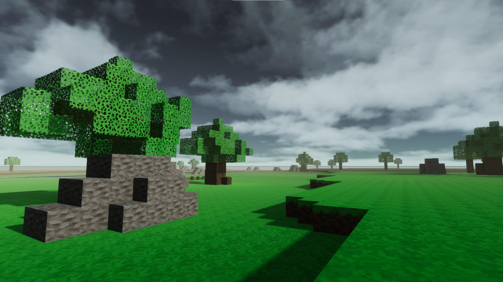
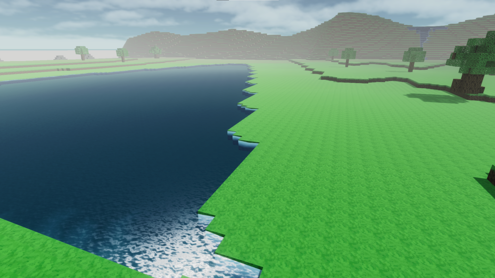
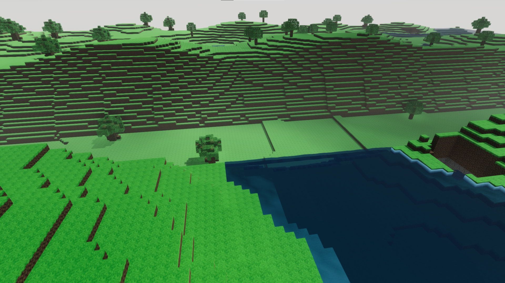
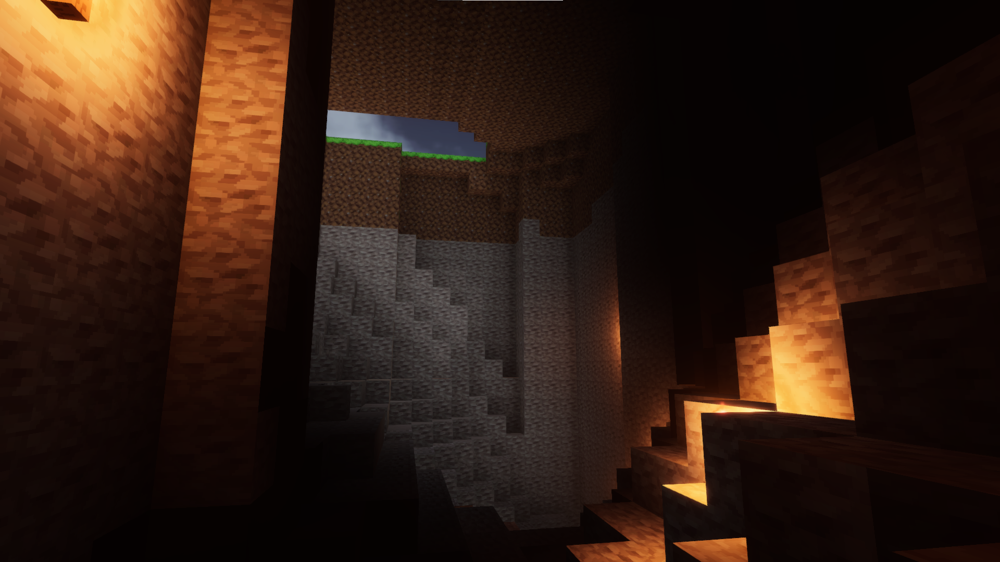
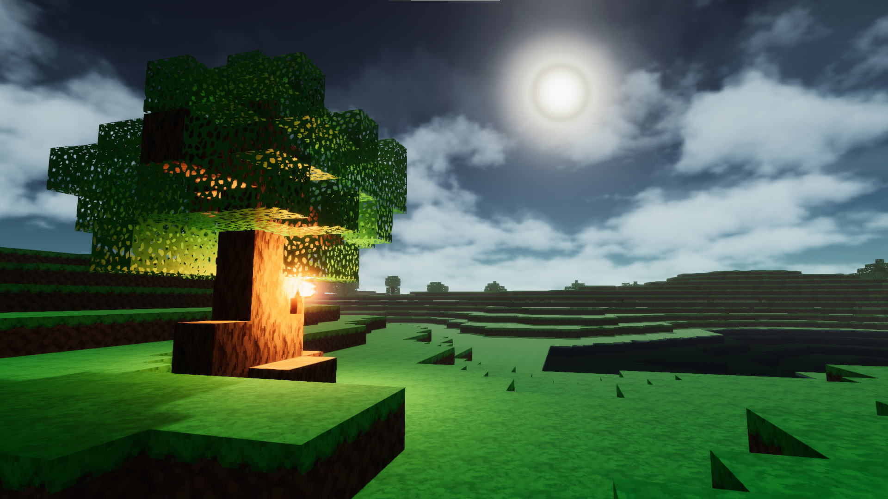
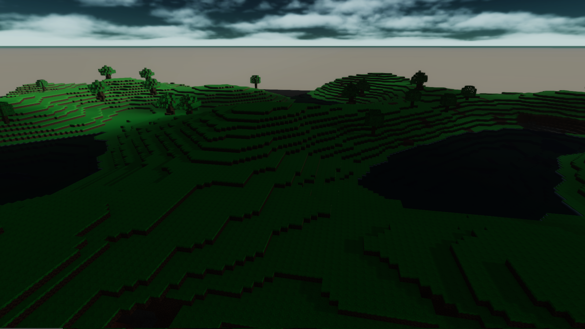
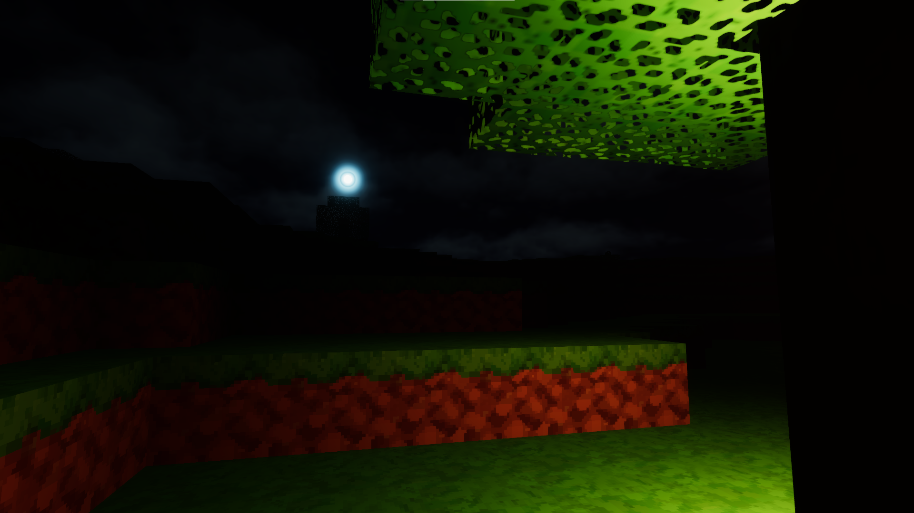
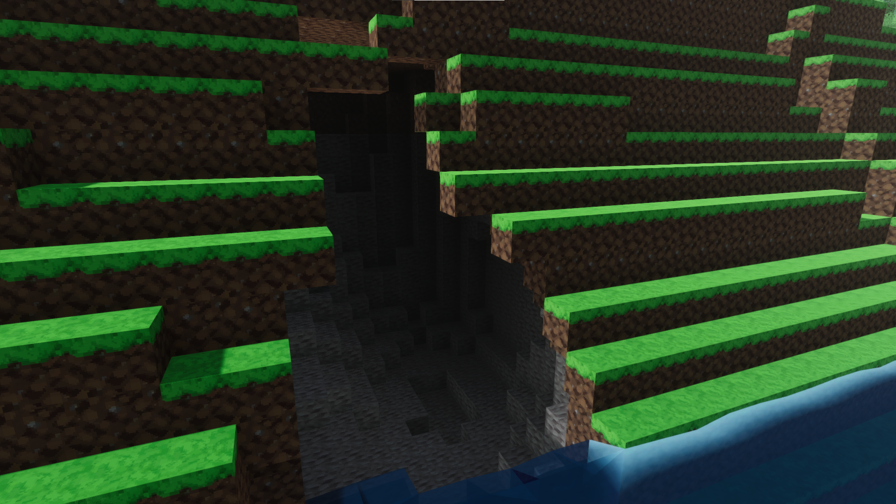
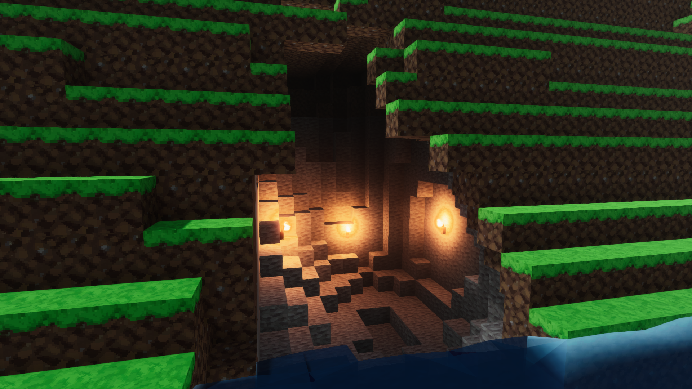
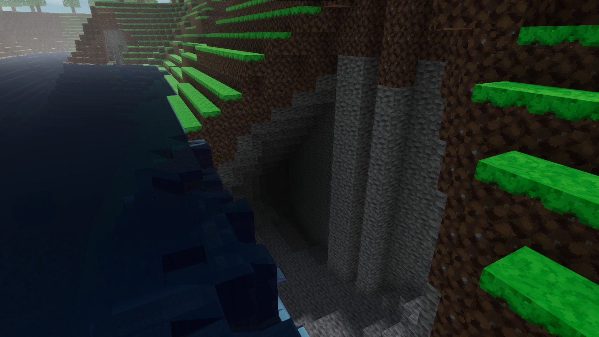